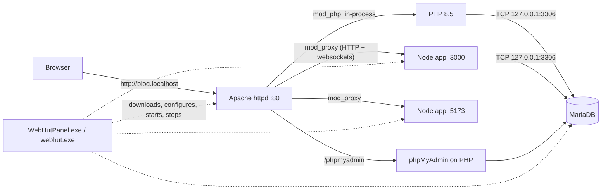

# 01 – Architecture

WebHut is a folder of official, unmodified server programs, plus a small control panel that downloads them, writes their configuration, and starts and stops them. There are no Windows services, no registry entries (apart from what the optional Visual C++ installer adds), and no installer for WebHut itself. Delete the folder and WebHut is gone.

## The pieces



- **Apache** is the front door on port 80.
  - `.php` files run **inside** Apache through `mod_php` (`php8apache2_4.dll`), the same model XAMPP uses. That is why WebHut installs the **Thread Safe** PHP build.
  - A request for a Node app's hostname is forwarded by `mod_proxy` to that app's port.
- **PHP** has no process of its own in the default mode. (In per-site mode, Apache launches `php-cgi.exe` workers instead; see [05](05-php-versions.md).)
- **MariaDB** is its own process on `127.0.0.1:3306`.
- **Node apps** each run as their own process tree (`cmd.exe` running your command, for example `npm run dev`), on their own port.
- **WebHutPanel.exe** (GUI) and **webhut.exe** (console) share the same core library. They're process managers and config writers: if the panel closes or crashes, the servers keep running, and reopening the panel picks them up again.

## Process model

| Process | Command WebHut runs (simplified) | How WebHut stops it |
|---|---|---|
| `httpd.exe` (parent + one worker child) | `httpd.exe -d <root>/apache -f <root>/config/apache/httpd.conf -C "Define WEBHUT_ROOT <root>" -C "Define PHP_DIR <root>/php/8.5" -C "Define WEBHUT_HTTP_PORT 80" -C "Define WEBHUT_MYSQL_PORT 3306"` | Signals the named event `ap<parent pid>_shutdown` that a console Apache waits on (a graceful stop), then kills the process tree if it's still running after 15 s. `httpd -k shutdown` only works for Apache installed as a Windows service, so WebHut never uses it. |
| `mariadbd.exe` | `mariadbd.exe --defaults-file=<root>/config/mariadb/my.ini --datadir=<root>/data/mariadb --port=3306 --bind-address=127.0.0.1 --log-error=<root>/logs/mariadb.err --pid-file=<root>/tmp/pids/mariadb.pid` | `mariadb-admin -u root shutdown` over TCP, then kills the process after 20 s (InnoDB recovers on the next start) |
| `cmd.exe` → `node.exe` (one per app) | `cmd.exe /d /s /c "<command> >> <root>/logs/node-<app>.log 2>&1"` in the app folder, with `PORT` set | `taskkill /PID <cmd pid> /T /F` (the whole tree) |

- Everything runs as the **current user**. Binding ports 80 and 3306 on Windows needs **no admin rights**.
- PIDs are kept in `tmp\pids\`. A PID only counts if that process started around when the PID file was written, so a stale file left over from before a reboot can never point WebHut at an unrelated process. To catch strays, WebHut also treats any `httpd.exe` or `mariadbd.exe` whose executable lives inside the WebHut folder as "running", so a server started by an earlier session (or by `webhut`) still shows up and can be stopped.
- Node output goes to a log file through `cmd.exe`'s own redirection, not through a pipe held by WebHut. That's why apps keep running and logging after the panel exits.

## Ports

| Port | Used by | Bound to |
|---|---|---|
| 80 | Apache (HTTP) | `127.0.0.1`, or all addresses with network access on (private-network clients only) |
| 3306 | MariaDB | `127.0.0.1` |
| 3000+ | Node apps (each app picks its own) | whatever the app binds; Apache proxies to `localhost:<port>` |

Everything is loopback-only by default, so nothing is reachable from your network and Windows Firewall doesn't prompt. Ports are configurable in **Settings**. Before starting a server, WebHut checks whether the port is free; if it isn't, it names the program holding the port (from `netstat -ano`).

## Hostnames: why `.localhost`

Each site gets a hostname such as `blog.localhost`. Chrome, Edge and Firefox resolve **any** `*.localhost` name to the loopback address by themselves (RFC 6761 reserves the name), so:

- there's no hosts-file editing, and
- no admin rights are needed.

Apache picks the site from the `Host` header. Each generated vhost also answers to `<name>.test`, for people who prefer that and are happy to add hosts-file entries (see [04](04-node-integration.md#custom-domains)).

> `*.localhost` resolution is done by the **browser**. Command-line tools and server-side code (curl, PHP's `file_get_contents`, Node's `fetch`) may not resolve subdomains of `localhost`. For server-to-server calls, use `http://127.0.0.1` with a `Host` header, or call the other app's port directly.

## Where things live, and why

| Folder | Owner | Replaced on upgrade? |
|---|---|---|
| `apache\`, `mariadb\`, `node\<major>\`, `apps\phpmyadmin\` | Upstream projects | **Yes.** The old folder is moved to `tmp\backup\` |
| `php\<branch>\` | Upstream + your `php.ini` | Yes, but `php.ini` is carried over |
| `config\apache\`, `config\mariadb\` | WebHut + you | Never |
| `config\apache\generated\` | WebHut | Rewritten on every Apache start and on **Refresh sites** |
| `config\apache\custom\` | You | Never |
| `data\mariadb\` | Your databases | Never |
| `data\backups\` | Automatic database backups | Never (only the oldest beyond the "keep" count are pruned) |
| `www\` | Your sites | Never |

Apache is started with `-d` pointing at the pristine `apache\` folder (for `modules\` and `conf\mime.types`) and `-f` pointing at WebHut's own `httpd.conf`, so Apache's stock `conf\httpd.conf` is simply never used.

## Portability: no hard-coded paths

WebHut works from `C:\webhut`, `D:\dev\webhut`, or a USB stick, and keeps working if you move the folder:

| File | Technique |
|---|---|
| `httpd.conf` and vhosts | `${WEBHUT_ROOT}`, `${PHP_DIR}`, `${WEBHUT_HTTP_PORT}` are defined on the command line with `-C "Define ..."` |
| `my.ini` | Holds no paths. Paths and port are passed as command-line options. |
| `php.ini` | Absolute paths (PHP needs them for `extension_dir` and `error_log`). WebHut remembers the root in `webhut.json` (`lastRoot`) and rewrites the old path in every `php.ini` when the folder moves. |
| phpMyAdmin `config.inc.php` | Uses `__DIR__` |
| `node-apps.json` | App folders inside WebHut are stored relative (`www/api`) |

The one hard rule is that **the path must not contain spaces**. WebHut refuses to run from such a path, and from inside `Program Files`, because Apache `Define` values and several PHP settings break on spaces.

## Environment for child processes

Every process WebHut launches (servers, Node apps, the **Shell** console) gets:

```text
WEBHUT_ROOT         C:/webhut
PATH              C:\webhut\php\8.5;C:\webhut\node\24;C:\webhut\node\24\global;C:\webhut\mariadb\bin;C:\webhut\tools;C:\webhut\apache\bin;<your PATH>
NPM_CONFIG_PREFIX C:\webhut\node\24\global      (npm -g installs stay inside WebHut)
NPM_CONFIG_CACHE  C:\webhut\tmp\npm-cache
COMPOSER_HOME     C:\webhut\tmp\composer
MYSQL_HOST        127.0.0.1
MYSQL_TCP_PORT    3306
```

Node apps additionally get `PORT`, `NODE_ENV=development` (unless you set it), `BROWSER=none` (to stop dev servers opening tabs) and any variables you set for that app.

Putting the active PHP folder first on `PATH` matters. PHP extensions such as `openssl`, `curl` and `sodium` depend on DLLs that sit in the PHP folder, and Windows finds them for the Apache process only through `PATH`.

## Request flow examples

**PHP site:** `http://blog.localhost/`
1. The browser resolves `blog.localhost` to loopback and connects to port 80.
2. Apache matches `ServerName blog.localhost` in `config\apache\generated\sites.conf`. `DocumentRoot` is `www/blog/public` if that folder exists, otherwise `www/blog`.
3. `mod_php` runs `index.php`, which connects to MariaDB at `127.0.0.1:3306`.

**Node app:** `http://api.localhost/users`
1. Apache matches `ServerName api.localhost` in `config\apache\generated\node-apps.conf`.
2. `ProxyPass / http://localhost:3000/ upgrade=websocket` forwards the request. Websocket upgrades (Vite HMR, Socket.IO) pass through.
3. If the app isn't running, Apache answers `503 Service Unavailable`.

## Setup: what happens on first run

1. **Resolve.** WebHut looks up the latest version and download URL of each component in parallel: `windows.php.net/downloads/releases/releases.json`, the MariaDB REST API, `nodejs.org/dist/index.json`, phpMyAdmin's `version.json`, and the Apache Lounge download page. A maintainer-published `versions.json` can pin any of them (see [07](07-packaging-and-releases.md#pinning-versions-with-versionsjson)).
2. **Download** into `tmp\downloads\`, verifying SHA-256 when the publisher provides one (PHP, MariaDB, Node.js, phpMyAdmin, Composer, CA bundle). Apache Lounge publishes no machine-readable checksum, so its zip is downloaded over HTTPS without one.
3. **Unpack** each zip into place, unwrapping a single top-level folder (and picking `Apache24\` out of the Apache Lounge zip).
4. **Write config** from templates embedded in `WebHutPanel.exe` (`overlay/` in the repo): `httpd.conf`, vhost files, `my.ini`, a `php.ini` that enables only the extensions present in that PHP build, a phpMyAdmin config with a random secret, and the `www\index.php` dashboard.
5. **Initialise MariaDB** with `mariadb-install-db.exe --datadir=data\mariadb`.

Every step is safe to re-run; finished downloads are reused.

## Design principles

1. **Official binaries, unmodified.** WebHut adds only config and a launcher. That keeps updates trivial, keeps WebHut's trust surface small, and keeps the licensing simple ([10](10-licensing.md)).
2. **Portable and self-contained.** One folder, no services, no admin rights in normal use.
3. **Your stuff is never overwritten.** Config, custom vhosts, `php.ini`, databases and sites survive upgrades.
4. **The CLI and GUI share one core.** Starting, stopping, status, sites, PHP switching and setup work the same from `webhut`. Node apps are edited in the panel or in `node-apps.json`. This helps scripting, CI and bug reports.
5. **Safe defaults.** Loopback only, `Require local` on every site, and loud warnings about production use.
