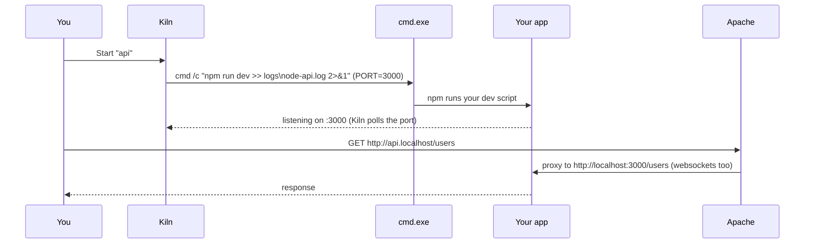

# 04 – Node.js integration

Kiln treats Node apps as first-class services next to Apache and MariaDB. Each one gets a row in the panel with Start/Stop, a log file, and a hostname.

## How it works



1. Kiln runs your **command** with `cmd.exe` in the app's folder. `PATH` contains the active Node (`node`, `npm`, `npx`), PHP, Composer and the MariaDB client.
2. `PORT` is set to the app's port. Most frameworks and `express` examples read `process.env.PORT`; for those that don't, put the port in the command (see recipes).
3. Output goes to `logs\node-<name>.log` (the **Logs** button opens it). Chained commands such as `npm install && npm run dev` are logged in full.
4. Apache's generated vhost forwards `http://<name>.localhost` to `http://localhost:<port>`, with `upgrade=websocket` so hot reload and Socket.IO work.
5. **Stop** kills the whole process tree, so watchers and child processes don't linger.

The app is also reachable directly at `http://localhost:<port>`. The Apache hostname is a convenience, not a requirement.

## Adding an app

**Node apps… → Add…**

| Field | Example | Notes |
|---|---|---|
| Name | `api` | Becomes `http://api.localhost` |
| Folder | `www/api` | Where `package.json` is. Folders inside Kiln are stored relative, so the Kiln folder stays portable. |
| Command | `npm run dev` | Anything you'd type in a terminal in that folder |
| Port | `3000` | Kiln suggests the next free one |
| Start with "Start all" | ✓ | Include in **Start all** / `kilnctl start` |
| Environment | `DATABASE_URL=mysql://root@127.0.0.1:3306/api` | One `KEY=value` per line |

Run `npm install` first: open **Shell**, `cd` into the folder, and run `npm install`. Kiln doesn't install dependencies by itself.

After you add, edit or remove an app, Kiln regenerates the vhosts and restarts Apache if it's running.

## Framework recipes

| Stack | Command | Port | Notes |
|---|---|---|---|
| Express / Fastify / Koa | `npm run dev` or `node server.js` | any | Listen on `process.env.PORT` |
| Vite (React, Vue, Svelte, ...) | `npx vite --port 5173 --strictPort` | 5173 | See the Vite notes below |
| Next.js | `npm run dev` | 3000 | `next dev` reads `PORT`. See the Next.js note below. |
| Nuxt | `npm run dev` | 3000 | Reads `PORT` |
| Astro | `npx astro dev --port 4321` | 4321 | |
| NestJS | `npm run start:dev` | 3000 | Use `app.listen(process.env.PORT ?? 3000)` |
| Remix / React Router | `npm run dev` | 5173 | Vite-based; see the Vite notes |
| Socket.IO server | `node index.js` | any | Websockets pass through Apache |

### Vite notes

- Vite accepts `localhost` and `*.localhost` hosts by default, so `http://<name>.localhost` works. If you use `.test` names, add them to `server.allowedHosts` in `vite.config.*`.
- Hot reload goes over a websocket. Through the proxy it normally works as is. If the browser console shows HMR connection errors, tell Vite which port the browser sees:

```js
// vite.config.js
export default {
  server: {
    port: 5173,
    strictPort: true,
    hmr: { clientPort: 80 },   // the Kiln HTTP port
  },
}
```

### Next.js note

In development, Next.js warns about or blocks cross-origin dev requests from hostnames it doesn't know. If you see that warning when using `http://<name>.localhost`, add the hostname to `allowedDevOrigins` in `next.config.js`:

```js
module.exports = { allowedDevOrigins: ['web.localhost'] }
```

### PHP back end + Node front end

A common setup is a Laravel or Symfony API in `www\api` (served by Apache and PHP at `http://api.localhost`) plus a Vite or React front end registered as a Node app `web` (`http://web.localhost`). They're separate origins, so:

- either enable CORS in the PHP app for `http://web.localhost`, or
- proxy API calls through Vite (`server.proxy: { '/api': 'http://127.0.0.1:80' }`, with `headers: { Host: 'api.localhost' }`).

For **Laravel + Vite** (where Vite only serves assets), don't register a Node app at all. Run `npm run dev` from the **Shell**; Laravel's Vite plugin handles the rest.

## IPv6 and "localhost"

Some dev servers listen only on `::1` (IPv6 loopback) when told to use `localhost`. Kiln's proxy targets `http://localhost:<port>`, and Apache tries each address `localhost` resolves to, so both IPv4-only and IPv6-only servers work. Kiln's "is it listening?" check also looks at both.

If an app shows **running** but Kiln logs "nothing is listening on port N", the app ignored `PORT` and picked its own port. Check `logs\node-<name>.log` for the port it chose, then either set that port in Kiln or pass the port in the command.

## npm, npx and global packages

The Kiln shell and every Node app use:

- `NPM_CONFIG_PREFIX = node\<major>\global`, so `npm i -g pnpm` installs inside Kiln, not in `%AppData%`.
- `NPM_CONFIG_CACHE = tmp\npm-cache`.

To use **pnpm** or **yarn**, install them globally from the Kiln shell (`npm i -g pnpm`), then use `pnpm dev` as the app's command.

## Switching Node versions

**Settings → Install latest LTS** downloads the newest LTS line into `node\<major>\`; several majors can sit side by side. Choose the active one in the **Node.js version** dropdown, then restart your Node apps. Packages with native add-ons may need `npm rebuild` after a major-version switch.

## Custom domains

Every generated vhost also answers to `<name>.test`. To use it, add a hosts entry. This needs admin rights: run Notepad as administrator and edit `C:\Windows\System32\drivers\etc\hosts`:

```text
127.0.0.1  api.test
127.0.0.1  blog.test
```

For any other hostname, add a vhost in `config\apache\custom\` (see [03](03-configuration.md#custom-vhosts)) plus a hosts entry.

## Testing on a phone

Turn on **Settings → Network → Allow access from other devices on my network**. Then, from a phone on the same Wi-Fi, open `http://<name>.<your-ip>.nip.io/`, for example `http://web.192.168.1.5.nip.io/`. Apache proxies it to the app like any other request. For Vite, also add `.nip.io` to `server.allowedHosts`. Details and safety notes are in [08](08-security.md#opening-kiln-to-your-lan-for-testing-on-a-phone).

## Running Node outside Kiln

Node apps don't have to be registered. Anything you start from the **Shell** uses Kiln's Node and works as usual. Registering an app just adds the panel controls, the log file, autostart and the `.localhost` hostname.
